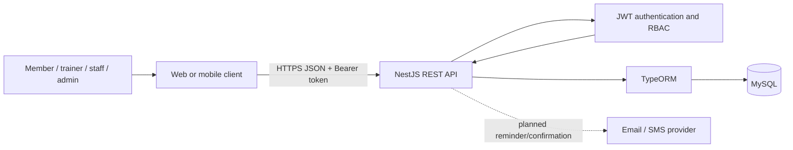
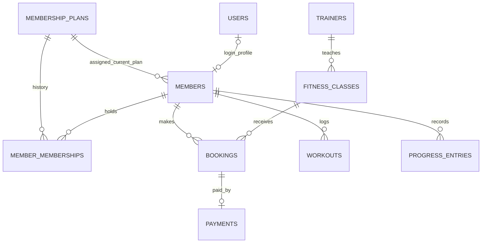

# FitConnect architecture and ERD

## System architecture (Lab 03)

The client sends a request to the API. The API validates its body, verifies the JWT for protected routes, checks the user's role and ownership, then uses TypeORM to query MySQL. A booking operation checks member/class existence, duplicate active reservations and remaining capacity before saving the booking. Notifications are an extension point, not configured in this starter.

## Entity relationship diagram (Lab 04 plus requested tracking)

Lab 04 cardinalities are preserved: a plan can have many members, a trainer can lead many classes, bookings resolve the many-to-many member/class relationship, and a booking has at most one payment. Membership periods are recorded separately so renewals do not overwrite history. `users` stores login credentials and roles; the member profile has an optional one-to-one user link.

## API and access overview

Base path: `/api/v1`. JSON uses camelCase. List endpoints accept `page` and `limit` (maximum 100). Login: `POST /auth/login`; protected requests use `Authorization: Bearer {{token}}`.

| Resource | Main operations | Access |
|---|---|---|
| Membership plans | list/read public; create/update/delete | Admin for changes |
| Members | list/read/create/update/deactivate; nested bookings | Staff/Admin; Admin for deactivation |
| Trainers | list/read/create/update/delete | Authenticated read; Admin changes |
| Classes | list/read/create/update/cancel | Authenticated read; Staff/Admin changes |
| Bookings | list/read/create/cancel/delete | Staff/Admin list; members may manage their own reservation; Admin permanent delete |
| Booking payment | create/read at `/bookings/:id/payment` | Staff/Admin create; authenticated read |
| Membership periods | list/create/cancel | Member read; Staff/Admin changes |
| Workouts and progress | list/create/update/delete | Members are scoped to their own profile; Staff/Admin can manage records |

## Security behavior

- bcrypt hashes passwords with a cost factor of 12.
- JWT carries user ID, email and role; the default lifetime is one hour.
- Invalid/missing tokens return 401; authenticated users without the required role receive 403.
- Global DTO validation rejects unknown fields and transforms request values. Rate limiting defaults to 100 requests per minute per client.
- `.env` is private; example values are placeholders. TLS must be terminated at a trusted HTTPS proxy in deployment.
